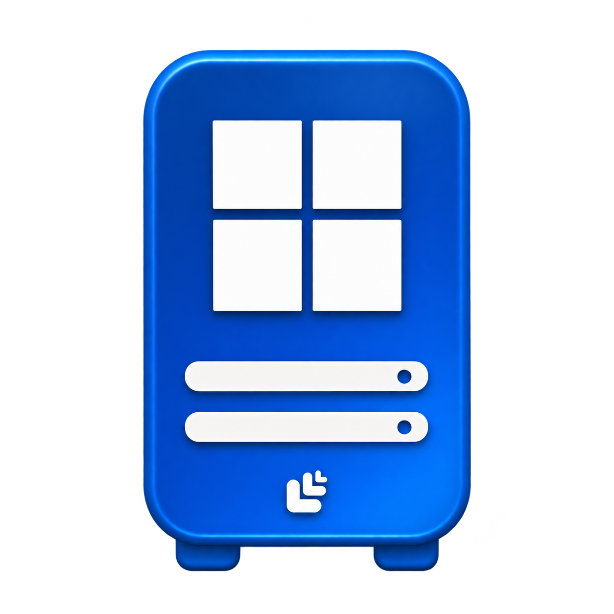

# Redes Brasil — Ícones de rede

Coleção de dez ícones para mapas e topologias de rede. Todos os arquivos são PNG com fundo transparente, degradê azul e relevo suave. Cada ícone inclui o símbolo da Redes Brasil em branco, integrado discretamente ao desenho.

## Galeria

| Ícone | Prévia | Arquivo |
| --- | --- | --- |
| Roteador |  | [router.png](router.png) |
| Switch |  | [switch.png](switch.png) |
| Servidor Linux |  | [linux-server.png](linux-server.png) |
| Servidor Windows |  | [windows-server.png](windows-server.png) |
| Access point |  | [access-point.png](access-point.png) |
| OLT |  | [olt.png](olt.png) |
| Cloud |  | [cloud.png](cloud.png) |
| PC |  | [pc.png](pc.png) |
| Proxmox |  | [proxmox.png](proxmox.png) |
| VMware |  | [vmware.png](vmware.png) |

## Uso

Baixe o PNG desejado e importe-o como imagem no seu editor de topologia ou aplicação. Os originais são preservados na resolução gerada; o formato é raster, sem versão SVG.

Exemplo em HTML:

```html

```

Para manter a proporção de ícones retangulares:

```css
.network-icon {
  width: 64px;
  height: 64px;
  object-fit: contain;
}
```

O arquivo [catalog.json](catalog.json) relaciona os nomes, caminhos, dimensões e checksums SHA-256 dos dez PNGs.

Ícones criados para a Redes Brasil com geração de imagens assistida por IA.
